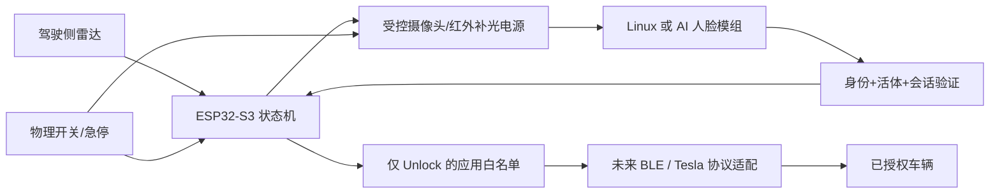

# 系统设计

## 架构

常供电只意味着持续待命；首版不实现硬件休眠。Linux 视觉板冷启动时间可能破坏靠近即解锁体验，需权衡待机功耗和延迟。雷达不承担身份验证，也不根据车内外存在直接解锁。

## 硬件候选（未确认采购清单，不要求重复购买）

| 部分 | 候选型号 | 选择与验证要求 |
|---|---|---|
| BLE 主控 | Espressif ESP32-S3-DevKitC-1-N8R8 | 台架开发候选，按实购物料核对 Flash/PSRAM、天线与可用 GPIO |
| 本地视觉计算 | Raspberry Pi 4 Model B 4GB | 优先台架验证，本地模型速度、散热和功耗需实测 |
| 红外摄像头 | Waveshare IMX462 IR-CUT Camera (A) | 近红外候选，驱动/系统版本先验证；不承诺穿贴膜车窗效果 |
| 雷达 | DFRobot SEN0395 24GHz | 可调检测区域，安装后必须测试行人、车内活动和邻车误触发 |
| 补光 | 带恒流驱动的 850nm 红外模组（型号待定） | 独立限流、温控、照射功率与眼安全评估；禁止 GPIO 直接供电 |
| 电源 | 车规保护 DC/DC 模组（型号待供电接口确认） | 宽压、欠压、反接、浪涌、保险丝；先确认车辆低压平台，禁止直接接开发板 |
| 急停 | 锁存式物理开关 + 输出电源切断 | 独立切断执行/补光，软件复位不应绕过硬件开关 |

厂商资料见 references.md。玻璃、贴膜与车型差异必须拿实际安装位置测，毫米波穿透能力不代表能可靠分辨车内外或指定方向。

## 模块职责与落地状态

| 模块 | 职责 | 首版 |
|---|---|---|
| unlock_core | 默认关闭、识别窗口、超时、冷却、急停 | 已实现并主机测试 |
| firmware main | ESP-IDF 生命周期与定时调度 | 已搭建，输出为日志 |
| proximity/output HAL | 雷达去抖、窗口、输出电源 | 待硬件型号 |
| vision | 本地录入、比对、质量判断、活体 | 待实现，Evidence 中布尔值是接口桩 |
| trusted link | 双向认证、挑战、消息 MAC、抗重放 | 待实现，不能把串口 true 当认证 |
| vehicle gateway | 唯一公开动作 Unlock，异步结果与未知状态处理 | 待实现，首版没有真实发包 |
| keystore | 加密存储、恢复、撤销、设备身份 | 待实现 |

## 时序

1. 上电默认 Disabled，自检、密钥/配对/开关检查完成后才能进入待命（首版固件保持 Disabled）。
2. 驾驶侧雷达触发，创建新 attempt，打开摄像头和补光；重复触发不延长 8 秒窗口。
3. 视觉节点在本次窗口中完成质量、身份与活体验证。结果必须绑定当前挑战；首版仅模拟 attempt 隔离，尚无加密挑战。
4. 无匹配、无活体或 8 秒到期：关闭输出，冷却 15 秒。恰好到期的成功结果也拒绝。
5. 验证成功：立即关闭输出，首版记录 DryRun。后续真实网关还须确认物理允许、配对可用、可信消息、单次解锁额度，才允许发 Unlock。
6. 真实发包后等待协议结果；失败/断连/响应丢失标为失败或未知，禁止重连自动重放。协议 ACK 与实际门锁状态分开记录。
7. 冷却后返回待命；急停在任何状态关输出并锁存，必须本地明确复位到 Disabled。

## 风险与应对

- 车窗反光与贴膜：遮光罩、镜头靠近玻璃、补光与镜头隔离，采集白天逆光/夜间/雨水数据；达不到准确率就不启用自动解锁。
- 活体：眨眼/转头不是充分防护；照片、手机视频、面具、反光攻击单独验收。高安全需求考虑深度/双目/专用活体模组，不把普通 IR 摄像头等同于活体能力。
- 驾驶权限：设备长期留车内且 Driver 密钥被窃取的后果超过本应用白名单；隐藏安装无法替代密钥安全。
- 供电与热：记录待机/识别功耗、车内高温、停车休眠影响；低电压/过温强制停止。开发板与树莓派均不能直接视作车规设备。
- 隐私：默认不保存原始影像；人脸模板加密、现场录入/删除，日志不记录生物数据、VIN 和私钥。
- 故障：输出默认低、硬件看门狗与独立断电；相机驱动阻塞不得阻塞超时/急停任务。首版输出为同步日志，未验证这些硬件保证。
